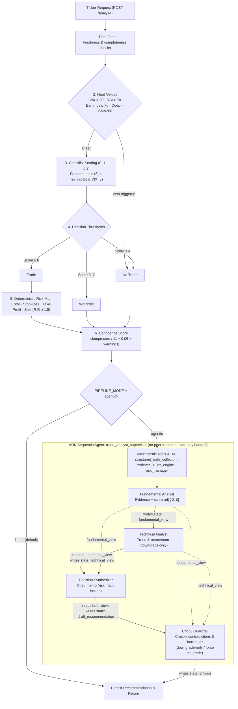

```text
     ᛟ  ═══════════════════════════════════════════════════════════════  ᛟ
    ╱│╲                                                                 ╱│╲
   ╱ │ ╲     ███████╗ ██████╗ ██████╗ ███████╗███████╗████████╗██╗     ╱ │ ╲
  ╱  │  ╲    ██╔════╝██╔═══██╗██╔══██╗██╔════╝██╔════╝╚══██╔══╝██║    ╱  │  ╲
 ▕───┼───▏   █████╗  ██║   ██║██████╔╝███████╗█████╗     ██║   ██║   ▕───┼───▏
  ╲  │  ╱    ██╔══╝  ██║   ██║██╔══██╗╚════██║██╔══╝     ██║   ██║    ╲  │  ╱
   ╲ │ ╱     ██║     ╚██████╔╝██║  ██║███████║███████╗   ██║   ██║     ╲ │ ╱
    ╲│╱      ╚═╝      ╚═════╝ ╚═╝  ╚═╝╚══════╝╚══════╝   ╚═╝   ╚═╝      ╲│╱
     ᛟ  ═════  Norse God of Justice · Deterministic Trade Verdict  ═════  ᛟ
```

[](https://github.com/ibudasov/forseti/actions/workflows/test.yml)
[](https://github.com/ibudasov/forseti/actions/workflows/test.yml)

## Goal

**Forseti** is an AI-assisted decision-support system for swing-trade research on US equities across high-conviction themes (AI, neoclouds, defence, nuclear, green energy, quantum, robotics, and space). Given a ticker, it evaluates market, technical, fundamental, and earnings data to issue a **Trade**, **Watchlist**, or **No Trade** verdict backed by deterministic risk math (entry range, stop-loss, take-profit, and position sizing) and an evidence-grounded explanation — it is not an autonomous trading bot.

A deterministic rules and risk engine is authoritative in every mode: optional AI specialists (fundamental, technical, synthesizer, and critic) can contribute evidence or downgrade a verdict, but can never inflate scores or alter risk numbers.

## Decision-Making Flow


