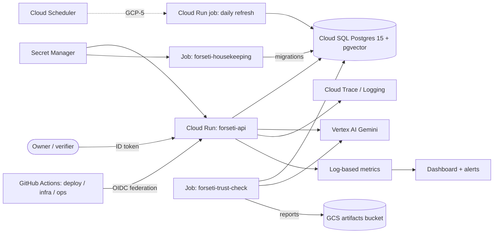

# Forseti on GCP: architecture

Project `forseti-505116`, region `europe-west4`. Everything is private: the API
has no public invoker, identities use short-lived credentials, and all
infrastructure is Terraform applied through reviewed pipelines.

## Components and reasoning

| Component | Choice | Why |
|---|---|---|
| API | Cloud Run service `forseti-api`, 1 vCPU / 1 GiB, 0–2 instances, concurrency 4 | Scale-to-zero keeps cost near nothing for a single-user system. The pipeline is plain request/response Python, so Cloud Run is enough. **Agent Engine** is deferred to Week 11: it adds managed sessions we do not need while the deterministic spine (ADR 005) owns orchestration. |
| Database | Cloud SQL Postgres 15, `db-f1-micro`, zonal | Cheapest tier that supports pgvector (ADR 001). Data is reproducible from ingestion, so HA is not worth its cost yet. |
| Jobs | Cloud Run jobs `forseti-housekeeping` and `forseti-trust-check` | Same image as the API; one-shot, retries off, run on demand. |
| Models | Vertex AI Gemini through the `forseti-api`/`forseti-jobs` identities | No API keys; billed to the project. |
| Observability | Logging, Trace, log-based metrics, dashboard, alerts | See `docs/observability.md`. |

## Request flow

1. Caller sends `POST /analyze` with an ID token; Cloud Run checks `run.invoker`.
2. The API reads market, fundamental and RAG data from Cloud SQL and runs the
   deterministic spine, which produces the entry/stop/take-profit/size.
3. Enforced agents (fundamental, technical, critic) and the typed decision
   synthesizer can only **downgrade** the decision (ADR 006–009). Risk numbers
   are never recomputed.
4. The run is persisted (`GET /runs/{run_id}`), a trace is exported to Cloud
   Trace, and a structured `analysis_completed` log feeds the metrics.

## Daily refresh flow

Cloud Scheduler triggers the refresh job as `forseti-scheduler` (arrives with
GCP-5, #127), which ingests prices, fundamentals and RAG documents into Cloud
SQL, then logs `daily_refresh_status` for the alerts. Until then data is loaded
by hand with the `make ingest*` targets.

## Identity and IAM

The identity matrix, resource grants and federation rules are generated from
`infra/terraform/bootstrap/identities.json`; see
[`docs/gcp-access.md`](gcp-access.md#identities-and-grants). They are not
copied here.

## Secrets and data

| Data | Where | Notes |
|---|---|---|
| Application data, runs, traces, vectors | Cloud SQL | Encrypted-only connections, no authorized networks |
| Database URL, Alpha Vantage key, owner DB URL, app DB password | Secret Manager | Mounted as env vars; only the named identities can read them |
| Terraform state | `forseti-505116-tfstate` bucket | Never in git |
| Trust and evaluation reports | `gs://forseti-505116-artifacts/reports/` | Written by `forseti-trust-check` |
| Container images | Artifact Registry | Cleanup policies enforced |

## Deployed Terraform resources

Every resource in `infra/terraform/main` must be mentioned here; the nightly
`doc-coverage` job in `infra.yml` fails otherwise.

| Terraform resource | Purpose |
|---|---|
| `google_cloud_run_v2_service.api` | The private API |
| `google_cloud_run_v2_job.housekeeping` | Migrations, roles, extensions |
| `google_cloud_run_v2_job.trust_check` | On-demand cloud trust check |
| `google_cloud_run_v2_service_iam_member.grants` | API invokers |
| `google_cloud_run_v2_job_iam_member.grants` | Job invokers (verifier runs the trust check) |
| `google_storage_bucket_iam_member.grants` | Bucket grants (empty until GCP-5) |
| `google_sql_database_instance.forseti_pg` | Postgres instance |
| `google_sql_database.forseti` | Application database |
| `google_sql_user.forseti_owner` | Owner database role used by housekeeping |
| `google_secret_manager_secret.database_url` | Application connection string |
| `google_secret_manager_secret_version.database_url` | Its value |
| `google_secret_manager_secret.owner_database_url` | Owner connection string |
| `google_secret_manager_secret_version.owner_database_url` | Its value |
| `google_secret_manager_secret.app_db_password` | Application role password |
| `google_secret_manager_secret_version.app_db_password` | Its value |
| `google_secret_manager_secret.alpha_vantage_api_key` | Market data key |
| `google_secret_manager_secret_iam_member.grants` | Secret accessors |
| `google_artifact_registry_repository.forseti` | Docker images |
| `google_monitoring_dashboard.forseti` | Forseti dashboard |
| `google_monitoring_notification_channel.owner_email` | Alert email |
| `google_monitoring_alert_policy.api_5xx` | API 5xx alert |
| `google_monitoring_alert_policy.daily_llm_cost` | Daily model cost alert |
| `google_monitoring_alert_policy.refresh_failed` | Failed refresh alert |
| `google_monitoring_alert_policy.refresh_missing` | Missing refresh alert |
| `google_monitoring_alert_policy.sql_connections` | Cloud SQL connection alert |
| `google_monitoring_alert_policy.sql_disk` | Cloud SQL disk alert |
| `google_monitoring_alert_policy.unpriced_run` | Unpriced model usage alert |
| `google_logging_metric.analysis_count` | Analyses by decision and cost status |
| `google_logging_metric.analysis_latency_ms` | Analysis latency |
| `google_logging_metric.analysis_cost_usd` | Analysis cost |
| `google_logging_metric.analysis_confidence` | Confidence distribution |
| `google_logging_metric.analysis_degraded_count` | Degraded analyses |
| `google_logging_metric.agent_degraded_count` | Degraded agents |
| `google_logging_metric.agent_downgrade_count` | Downgrades per agent |
| `google_logging_metric.daily_refresh_status` | Refresh outcome |

## Cost

Actuals come from the monthly billing report (see the runbook's monthly cost
check); the owner fills in the last column.

| Item | Expected driver | Actual (EUR / month) |
|---|---|---|
| Cloud SQL `db-f1-micro` | Always-on instance and storage | _from billing report_ |
| Cloud Run API and jobs | Request time only, scale to zero | _from billing report_ |
| Vertex AI Gemini | Per analysis; alert on daily cost | _from billing report_ |
| Artifact Registry, Secret Manager, logging | Storage and volume | _from billing report_ |

The budget in bootstrap alerts but does not cap spending.

## Known limits

- Single region (`europe-west4`); no failover.
- Cloud SQL is zonal without an SLA, no HA and no point-in-time recovery.
- Cold starts: min instances is 0, so the first request after idle is slow.
- Nightly refresh is not yet scheduled (GCP-5).

## Next steps

- Week 11: evaluate Vertex AI Agent Engine for hosting the agents.
- Week 12: Gemini Enterprise integration.
